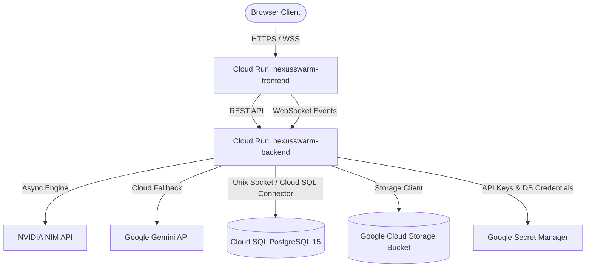

# 🚀 Google Cloud Deployment Guide for NexusSwarm

This directory contains automated provisioning scripts and Google Cloud Build configurations for deploying NexusSwarm (FastAPI Backend + React Frontend + Cloud SQL + GCS + Secret Manager) to **Google Cloud Platform (GCP)**.

---

## 🏗️ Architecture on GCP



### Key Deployment Services:
1. **Cloud Run (`nexusswarm-backend`)**:
   - Runs the FastAPI orchestration backend.
   - **Critical Settings**:
     - `--no-cpu-throttling`: Allocates CPU continuously so background `asyncio` swarm pipelines run to completion after `POST /submit-task` responds.
     - `--timeout=300`: Allows long-lived WebSocket streaming sessions and multi-step pipeline executions without socket timeouts.
     - `--add-cloudsql-instances`: Attaches the Cloud SQL PostgreSQL instance via unix domain sockets.
2. **Cloud Run (`nexusswarm-frontend`)**:
   - Serves the compiled Vite React frontend on Nginx port 8080.
3. **Cloud SQL (PostgreSQL 15)**:
   - Persists task history, benchmark metrics, model router telemetry, and pgvector embeddings.
4. **Google Cloud Storage (GCS)**:
   - Stores workspace artifacts, generated codebases, reports, and delivery files.
5. **Secret Manager**:
   - Stores `nexusswarm-nvidia-key`, `nexusswarm-gemini-key`, and `nexusswarm-db-pass`.

---

## 📋 Prerequisites

1. **Google Cloud SDK (`gcloud`)** installed and authenticated:
   ```bash
   gcloud auth login
   gcloud config set project YOUR_GCP_PROJECT_ID
   ```
2. **API Keys**:
   - **NVIDIA NIM API Key**: Free from [build.nvidia.com](https://build.nvidia.com)
   - **Google Gemini API Key**: From [Google AI Studio](https://aistudio.google.com)

---

## 🛠️ Step 1: Provision Cloud Infrastructure (One-Time Setup)

Run the automated bootstrapping script from the repository root:

```bash
chmod +x deploy/setup.sh
./deploy/setup.sh
```

### What `setup.sh` does:
- Enables APIs: `run.googleapis.com`, `sqladmin.googleapis.com`, `secretmanager.googleapis.com`, `cloudbuild.googleapis.com`, `artifactregistry.googleapis.com`.
- Creates Artifact Registry Docker repository: `nexusswarm`.
- Creates GCS storage bucket: `gs://nexusswarm-outputs-${PROJECT_ID}`.
- Creates Cloud SQL PostgreSQL 15 instance: `nexusswarm-db` (`db-f1-micro`).
- Creates secrets in Secret Manager:
  - `nexusswarm-nvidia-key`
  - `nexusswarm-gemini-key`
  - `nexusswarm-db-pass`
- Grants IAM permissions (`secretAccessor`, `cloudsql.client`, `storage.admin`) to Cloud Run's default compute service account.

---

## 🚢 Step 2: Deploy to Cloud Run via Cloud Build

### Option A: Full Stack Deployment (Backend + Frontend)
Deploys the backend, captures its Cloud Run URL, passes it into the frontend build args, and deploys the frontend:

```bash
gcloud builds submit --config=deploy/cloudbuild.yaml
```

### Option B: Deploy Backend Only
When modifying backend code, prompt pipelines, or agents:

```bash
gcloud builds submit --config=deploy/cloudbuild-backend.yaml
```

### Option C: Deploy Frontend Only
When modifying React components, UI state, or styling:

```bash
gcloud builds submit --config=deploy/cloudbuild-frontend.yaml
```

---

## ⚙️ Cloud Run Environment Variables & Secrets Reference

### Backend (`nexusswarm-backend`)

| Variable / Secret | Source | Purpose |
| :--- | :--- | :--- |
| `APP_ENV` | Env Var | Set to `production` |
| `DATABASE_URL` | Env Var | Asyncpg connection: `postgresql+asyncpg://postgres:$$DB_PASSWORD@/nexusswarm?host=/cloudsql/${_DB_CONNECTION}` |
| `GCS_BUCKET` | Env Var | Bucket name for generated artifact storage |
| `CORS_ALLOWED_ORIGINS` | Env Var | Comma-separated allowed frontend origins |
| `TRUSTED_HOSTS` | Env Var | Comma-separated host header whitelist |
| `NIM_ORCHESTRATOR_MODEL` | Env Var | Default: `nvidia/nemotron-3-super-120b-a12b` |
| `NIM_MANAGER_MODEL` | Env Var | Default: `nvidia/nemotron-3-nano-30b-a3b` |
| `NIM_WORKER_MODEL` | Env Var | Default: `meta/llama-3.2-11b-vision-instruct` |
| `NVIDIA_API_KEY` | Secret | `nexusswarm-nvidia-key:latest` |
| `GEMINI_API_KEY` | Secret | `nexusswarm-gemini-key:latest` |
| `DB_PASSWORD` | Secret | `nexusswarm-db-pass:latest` |

---

## 🔍 Troubleshooting & Cloud Run Health

### 1. Request Timed Out during Swarm Execution
- **Fix**: Ensure `--no-cpu-throttling` is specified in Cloud Run deployment (already configured in `cloudbuild.yaml` and `cloudbuild-backend.yaml`).
- Ensure `Settings.agent_timeout_seconds` in `backend/config.py` is at least 60–120s.

### 2. Viewing Live Cloud Run Logs
```bash
# View backend logs in real-time
gcloud beta run services logs tail nexusswarm-backend --region=us-central1

# View frontend logs in real-time
gcloud beta run services logs tail nexusswarm-frontend --region=us-central1
```

### 3. Testing Cloud Run Endpoints Directly
```bash
# Health check
curl https://nexusswarm-backend-669943047856.us-central1.run.app/health

# Agents registry check
curl https://nexusswarm-backend-669943047856.us-central1.run.app/agents
```
